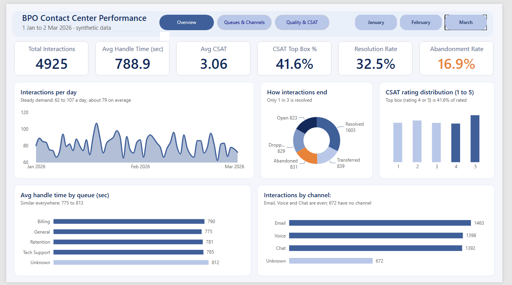
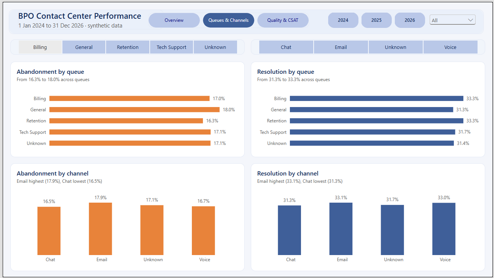
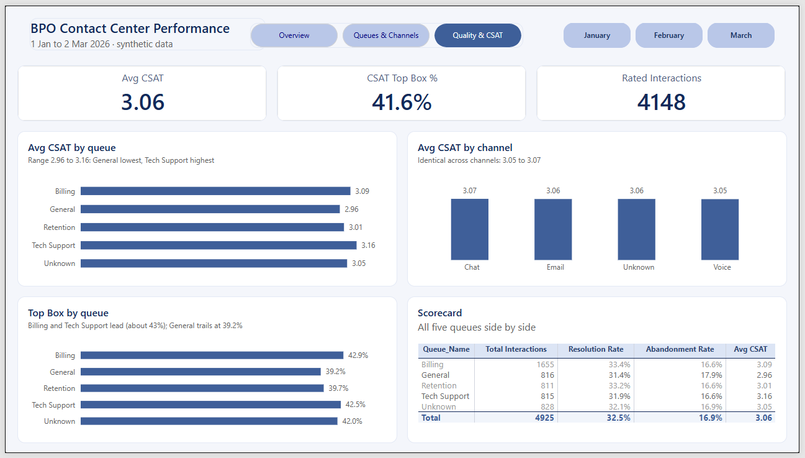
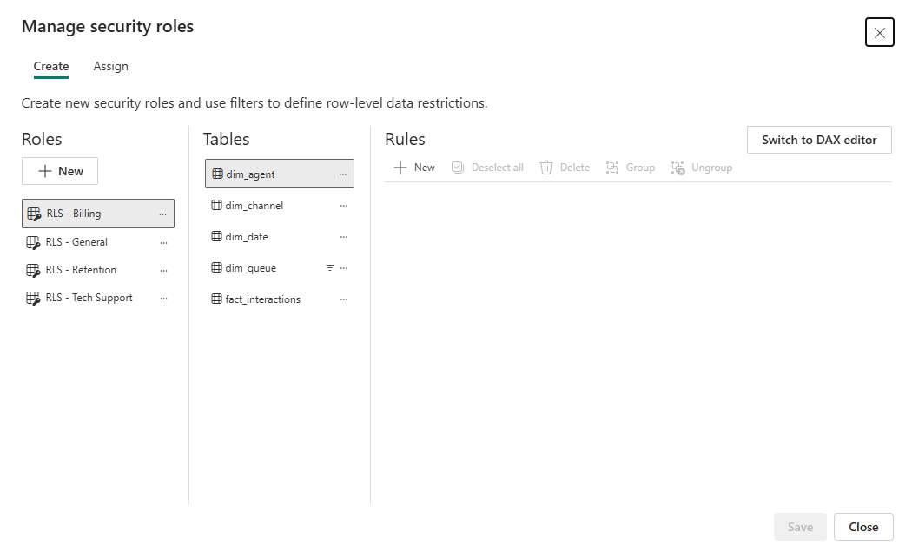
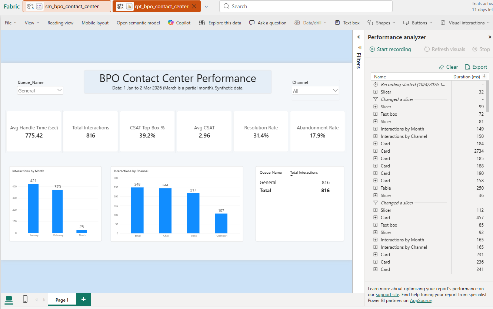
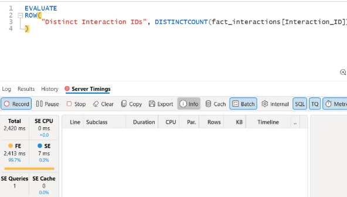
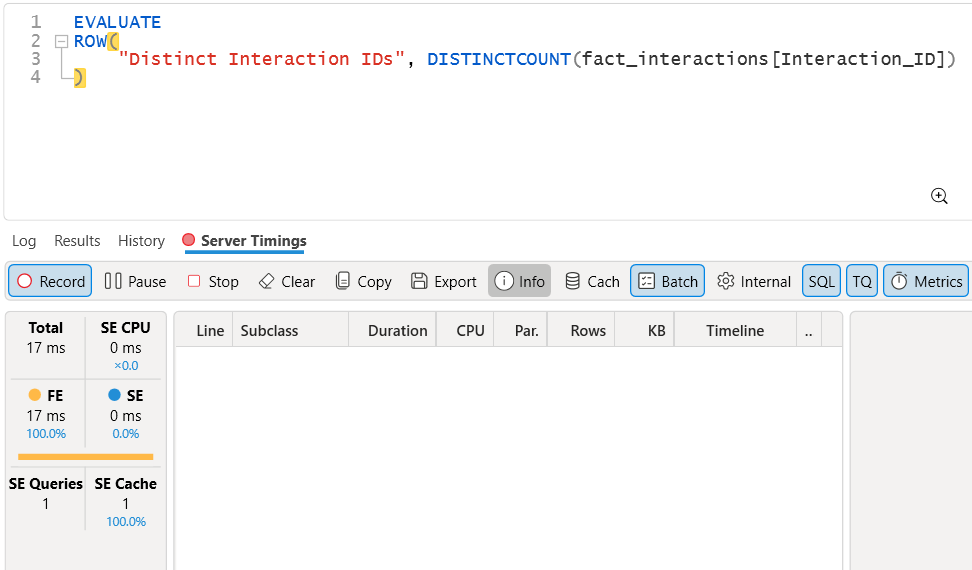
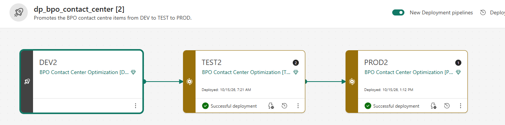
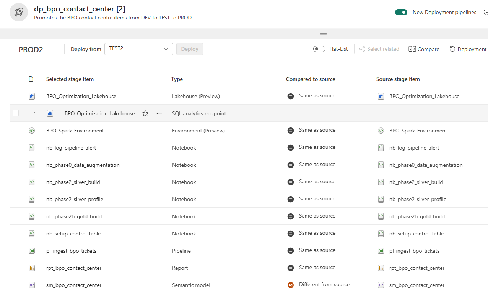
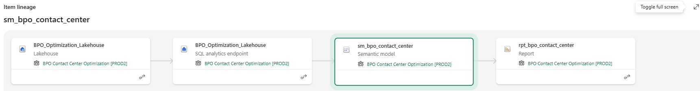

# BPO Contact Center Optimization Pipeline

An end-to-end data engineering and analytics solution built on Microsoft Fabric. This project processes multi-year customer interaction data using a Medallion Architecture, optimizing query performance via Direct Lake mode, and enforcing robust data governance.

## 📊 Dashboard Preview

A three-page Power BI report on a Direct Lake semantic model, built on **synthetic data** (1 Jan to 2 Mar 2026; March is a partial month). Screenshots are from the Test workspace (TEST2).

> **Why screenshots and not a live link?** The semantic model uses row-level security, which Power BI's Publish to web does not support, and the project runs on a temporary Fabric trial. The report is fully interactive in Fabric: month buttons filter all pages, and the page buttons navigate between them.

### Page 1: Overview

Six KPI cards, daily demand, how interactions end, CSAT rating distribution, handle time by queue, and interactions by channel.

### Page 2: Queues & Channels

Abandonment and resolution rates by queue and by channel, with queue and channel filter buttons.

### Page 3: Quality & CSAT

CSAT by queue and channel, top-box rate by queue, and a queue scorecard.

### 📊 Dashboard Preview

A fully interactive three-page Power BI report built on a Direct Lake semantic model using synthetic data. 

https://github.com/user-attachments/assets/5bf76196-1763-4fe8-abb8-7af514909602

### What the data shows
- **4,925** cleaned interactions: **32.5%** resolved, **16.9%** abandoned, average CSAT **3.06 / 5**, top box (rating 4 or 5) **41.6%**.
- Performance is nearly identical across queues and channels (for example, abandonment 16.2 to 17.9%). No single queue stands out, which is expected for generated data. The point of the project is the pipeline, model and report design, not the business findings.

---

## 🏗️ Architecture Overview
The pipeline follows a structured Medallion Architecture managed natively via Microsoft Fabric Git Integration:
* **Bronze Layer:** Parameterized incremental ingestion of raw operational files into Delta tables using Data Factory.
* **Silver Layer:** Idempotent cleaning, data-quality auditing, and automated quarantine routing using PySpark.
* **Gold Layer:** Dimensional modeling transforming cleaned interaction logs into a high-performance Star Schema.
* **Semantic Layer:** Direct Lake semantic model with measure-only DAX expressions and Row-Level Security (RLS).

---

## 🛠️ Tech Stack & Core Tools
* **Orchestration & Ingestion:** Microsoft Fabric Data Factory (Pipelines & Copy Activities) ✅
* **Compute & Engineering:** Apache Spark (PySpark Notebooks) ✅
* **Storage Engine:** Delta Lake (Parquet format) ✅
* **Modeling & Security:** Fabric web model editor (Direct Lake semantic model, DAX measures, static row-level security roles) ✅
* **Performance Tuning:** DAX Studio (XMLA connection, Server Timings, cold vs warm query profiling) ✅
* **DevOps (Phase 5):** Fabric Git Integration ✅, Deployment Pipelines ✅ (manual promotion across Development, Test and Production)

---

## 📈 Project Status & Metrics Log
*This section is a living log: results for each phase, with what was verified and what was not.*

### Phase 0: Data Augmentation ✅
- **Goal:** Turn a 5,000-row messy seed CSV into a 180,000-row synthetic source, reproducibly.
- **Method:** Loaded the seed as strings, cast `Talk_Time_Sec` with `try_cast` so bad values become null instead of causing an error, cross-joined with a 2024-01-01 to 2026-12-31 date spine, shuffled and limited to 180,000 rows, regenerated `Talk_Time_Sec` from the seed's mean and standard deviation, and injected anomalies (~2% `CSAT_Rating` set to "Five", ~1% `Agent_ID` set to null).
- **Reproducibility:** `SEED = 42`.
- **Output:** CSV with header in `Files/landing/bronze_customer_tickets_raw/`.
- **Verified:** 180,000 rows read back; 5,376 rows with `CSAT_Rating = 'Five'`; 3,704 null `Agent_ID`. Both counts are above the injected rates because the seed already had some dirty values.
- **Known limitation:** Both injections used the same random seed, so the two anomalies probably overlap heavily.

### Phase 1: Bronze Ingestion Pipeline ✅
- **Goal:** Load raw ticket data into Bronze incrementally, so each run only picks up rows newer than the last load.
- **Method:** Pipeline `pl_ingest_bpo_tickets` runs 4 activities in order: `cp_http_to_staging` (HTTP CSV to `dbo.stg_customer_tickets`, Overwrite), `lkp_get_watermark` (reads `control.load_log`), `cp_staging_to_bronze` (T-SQL filter `try_cast(sim_date AS DATE) > watermark`, Append to `dbo.bronze_customer_tickets`), and `nb_update_watermark` (runs `nb_setup_control_table` to save the new newest date).
- **Watermark design:** `control.load_log` holds exactly one row, upserted with `MERGE INTO` inside `update_watermark()`. The Lookup activity can only read a table's first row, so one row keeps the read simple.
- **Parameters:** `p_source_path`, `p_load_date`, `p_environment`.
- **Resilience:** Retry 2 times, 60 seconds apart, on the notebook activity, because trial Spark capacity sometimes throttles (HTTP 430).
- **Verified:** 180,000 rows in staging and Bronze; watermark = 2026-12-31 with `rows_loaded` = 180,000. A 2,000-row test batch dated January 2027 loaded only the new rows, and a rerun loaded 0.
- **Known limitation:** Bronze keeps the raw data as it arrived: 180,000 rows but only 5,000 distinct `Interaction_ID` values, because the repeats come from the Phase 0 source. Deduplication is handled in Silver. The watermark follows the `sim_date` column from the Phase 0 date spine (latest value 2026-12-31). The dates shown in the dashboard (1 Jan to 2 Mar 2026) are a different range, so the two should not be compared.
- **Failure alerting:** Each of the four pipeline activities has a red On fail path to `nb_log_pipeline_alert`, which writes the pipeline name, run ID, failed activity, and error message to `control.pipeline_alerts`. A Fail activity then ends the run as Failed so errors can't hide as green runs. The chain between activities uses On success links, so a failed step stops everything after it.
- **Verified (alerting):** Tested end to end by making a temporary test activity fail on purpose: the run showed Failed in Monitor and the alert row held the real run ID and error text. The same pattern was copied to the four real activities, which passed validation, and a normal run succeeded with staging and Bronze both at 180,000 rows.
- **Known limitation (alerting):** The alert logger runs on Spark, so it can be delayed or fail when the trial capacity is throttled (HTTP 430). The alert is a table, not an email or Teams message.

### Why a Data Pipeline instead of Dataflow Gen2?
- A pipeline is built for orchestration: ordered steps, parameters, passing a value (the watermark) between activities, retries, and calling notebooks.
- Dataflow Gen2 is a low-code Power Query tool for shaping data. It cannot easily read a watermark, use it as a filter, and update it afterwards in one controlled flow.
- The pipeline moves and tracks the data. Transformations happen later in notebooks (Silver and Gold).

### Phase 2: Silver Cleaning ✅
- **Goal:** Turn raw Bronze data into trusted, one-row-per-ticket Silver data, and keep every rejected row with a reason.
- **Method:** PySpark in `nb_phase2_silver_build`. Standardized labels (Channel, Queue_Name, Status), converted types with `try_cast`, read two timestamp formats, repaired the CSAT word "Five" as 5, and treated hold time "N/A" as null. Rows with a non-numeric CSAT, missing Agent_ID, missing Timestamp, or invalid talk/hold time go to quarantine with a reason. Quarantine runs before deduplication, then the latest row per Interaction_ID is kept using a window function.
- **Output:** `dbo.silver_customer_tickets` (4,925 rows), `dbo.quarantine_customer_tickets` (11,675 rows), `dbo.silver_dq_audit` (one row per run).
- **Verified:** Quarantine (11,675) plus the clean rows before deduplication (168,325) equals the 180,000 Bronze rows; deduplication then keeps the latest row per Interaction_ID, which leaves 4,925 in Silver. Silver has one row per ID, no null Agent_ID or Timestamp, no negative talk time, and CSAT only 1-5 or null. Re-running the writes gave identical counts (idempotent).
- **Known limitation:** 75 of 5,000 tickets (1.5%) have no clean copy, because every copy is missing an Agent_ID or Timestamp, so they exist only in quarantine. Silver keeps about 4,925 of the 180,000 rows because Phase 0 repeats each ID with different values, so keeping the latest copy discards the rest.

### Phase 2B: Gold Star Schema ✅
- **Goal:** Reshape the clean Silver data into a star schema that Direct Lake and Power BI can query quickly.
- **Method:** Built four dimension tables (`dim_agent`, `dim_channel`, `dim_queue`, `dim_date`) with surrogate keys, then `fact_interactions` at one row per Interaction_ID. Null Channel and Queue values map to an "Unknown" member, so no rows are lost in the joins. `dim_date` covers 2024 to 2027 so it also covers the January 2027 incremental test batch. Every table is rebuilt with Overwrite, so re-runs are safe.
- **Output:** `dbo.dim_agent` (40), `dbo.dim_channel` (4), `dbo.dim_queue` (5), `dbo.dim_date` (1,461), `dbo.fact_interactions` (4,925).
- **Verified:** Fact rows match Silver rows and distinct IDs (4,925). 0 orphan keys across all four dimensions. Identical results on re-run (idempotent).
- **Known limitation:** About 14% of facts have an Unknown channel (672 rows) and about 17% have an Unknown queue (828 rows), because those nulls were deliberately kept in Phase 2. `Status` is kept in the fact table as a plain text column instead of its own dimension.

### Phase 3: Direct Lake Semantic Model + RLS ✅
- **Goal:** Build a semantic model on the Gold star schema, with relationships, DAX measures and row-level security (RLS), reading the Delta tables directly in Direct Lake mode.
- **Method:** Created `sm_bpo_contact_center` as Direct Lake on SQL endpoint from the five Gold tables. Four many-to-one, single-direction relationships from `fact_interactions` to each dimension, with `dim_date` marked as the date table. Direct Lake Behavior is set to Direct Lake Only, so a query that cannot be served from the Delta files shows an error instead of silently falling back to DirectQuery. Key and helper columns are hidden, `month_name` and `day_name` have sort-by columns, and Discourage implicit measures is on. 10 explicit DAX measures sit in display folders (Time Metrics, Customer Satisfaction, Outcomes). 4 RLS roles (`RLS - Billing`, `RLS - General`, `RLS - Retention`, `RLS - Tech Support`) each filter `dim_queue` by `Queue_Name`. Testing the roles needed a fixed-identity cloud connection (OAuth 2.0, SSO off), because "Test as role" does not work with the Direct Lake SSO default.
- **Output:** Semantic model `sm_bpo_contact_center` and a starter report `rpt_bpo_contact_center` (card, queue table, monthly column chart).
- **Verified:** Total Interactions = 4,925, matching `fact_interactions`. Viewing as `RLS - Billing` shows only Billing (1,655), and viewing as `RLS - Retention` shows only Retention (811). Months sort January to March, not alphabetically. Performance analyzer showed no errors on any visual under Direct Lake Only, so there was no fallback to DirectQuery.
- **Known limitation:** Interactions with an Unknown queue (828) are not visible to any queue role, by design. The roles have no members assigned (testing used "Test as role" only). Avg Handle Time does not equal Avg Talk Time + Avg Hold Time, because Avg Hold Time skips interactions with no hold value, while handle time counts a missing hold as 0. Resolution Rate divides by all interactions, including Open ones. Abandonment Rate counts only the "Abandoned" status, and "Dropped" is kept separate. The fixed-identity connection `conn_bpo_lakehouse_fixed` is a Fabric account setting and is not stored in Git. The report is a starter with three visuals, and the full dashboard is Phase 3B.

### Phase 3B: Power BI Report ✅
- **Goal:** Build a one-page contact center dashboard on top of the Direct Lake semantic model, with every number coming from model measures.
- **Method:** Built `rpt_bpo_contact_center` in the Fabric web editor as a thin report connected to `sm_bpo_contact_center`. Added the measure `CSAT Top Box %` (ratings of 4 or 5 divided by rated interactions, so unrated interactions are excluded).
- **Output:** One page with 6 KPI cards (Total Interactions, Avg Handle Time, Avg CSAT, CSAT Top Box %, Resolution Rate, Abandonment Rate), a monthly chart, a channel chart, a queue table, and Queue and Channel slicers. Unknown queue/channel members stay visible so totals match 4,925.
- **Verified:** Cards match the model (4,925 / 788.92 / 3.06 / 32.5% / 16.9%). Top Box check: 778 + 946 = 1,724 of 4,148 rated = 41.6%. Month and channel bars each add up to 4,925. Voice + Billing slicers gave 485, matching the table. Viewing as `RLS - Billing` showed 1,655 only. Performance analyzer showed no fallback errors under Direct Lake Only (slowest first load about 1.7 s, a rough check, not the Phase 4 benchmark).
- **Known limitation:** Data is synthetic and covers 1 Jan to 2 Mar 2026 (March is partial), so differences between queues and channels are not meaningful business insights. The slicers showed an extra (Blank) member with no rows behind it; it is hidden with an "is not blank" filter on each slicer and the cause was not confirmed. Top Box has no single official definition; this project uses 4 or 5.
- **Evidence:**
  
  

### Phase 4: Performance Profiling ✅
- **Goal:** Measure how fast the semantic model answers queries, and compare a first-use (cold) query with repeated (warm) queries.
- **Method:** Connected DAX Studio to `sm_bpo_contact_center` through the XMLA endpoint and used Server Timings. Ran two saved DAX queries: a queue summary matching the report table, and a distinct count on a column no earlier query had used. Warm tests used five runs each with Clear on Run on.
- **Output:** Two query files, two saved timing files and a short comparison note in `docs/diagnostics/`.
- **Verified:** Query results matched the report (4,925 interactions; Billing 1,655, General 816, Retention 811, Tech Support 815, Unknown 828). Warm runs took 16 to 33 ms (median 17 ms). One first-use query on a new column took 2,420 ms, and the same query took 31 ms on the rerun. No fallback errors under Direct Lake Only.
- **Known limitation:** Only one cold sample. Clear Cache and a model refresh did not produce a cold run. The cause of the slow first run is probably the column loading into memory, but this is not confirmed. Warm timings move in steps of about 16 ms, so small differences are noise. Small data on a trial capacity. Queries ran as admin, so row-level security was not applied. Warm runs showed storage engine cache hits even with Clear on Run on; the cause was not confirmed, so warm timings may include query caching. Timings were measured on the first trial, before the rebuild, and were not repeated.
- **Evidence:** Two query files, two saved timing files and a short comparison note in `docs/diagnostics/`; cold-run and warm-run screenshots in `docs/screenshots/`. The 2,420 ms first run is shown only in the cold-run screenshot.



### Rebuild from Source Control ✅

- **Goal:** Prove the whole solution can be rebuilt from GitHub alone if a workspace is lost (the 60-day Fabric trial ended).
- **Method:** Created a new workspace on a new trial capacity in a different region, connected it to this repo and synced all 11 items. Items arrive without data, so I re-attached the lakehouse in the 6 notebooks, created new connections, re-ran the pipeline, Silver and Gold notebooks, repointed the Direct Lake model to the new lakehouse with the semantic-link-labs function `update_direct_lake_model_connection`, and recreated the fixed-identity connection used for row-level security.
- **Output:** A working copy of the full solution, with the updated notebook, pipeline and model definitions committed.
- **Verified:** Every count matched the original: 180,000 rows in staging and Bronze, 4,925 in Silver, 11,675 in quarantine, dimensions 40 / 4 / 5 / 1,461 and 4,925 fact rows. The report KPIs and all four RLS roles matched too.
- **Known limitation:** Git saves item definitions only, not data, connections or the deployment pipeline. A workspace cannot move to a capacity in another region while it holds Fabric items, so this was a rebuild, not a move. Connections had to be recreated by hand.

### Phase 5: Deployment ✅
- **Goal:** Promote the solution from Development to Test to Production with a Fabric Deployment Pipeline, and check that each stage works with its own data.
- **Method:** Used the rebuilt workspace (see Rebuild above) as the Development stage, named DEV2, and created two more workspaces, TEST2 and PROD2, plus one Deployment Pipeline, `dp_bpo_contact_center`. DEV2 is Git-connected; TEST2 and PROD2 are not. Deployed the 11 items from Development to Test, then from Test to Production. In Test and in Production, ran the control setup cells of `nb_setup_control_table`, the ingest pipeline, and the Silver and Gold notebooks, repointed the semantic model to that stage's lakehouse with `update_direct_lake_model_connection` (semantic-link-labs), and refreshed it.
- **Output:** Three working stages, each with its own lakehouse data, semantic model and report.
- **Verified:** Same counts in all three stages: Bronze 180,000, Silver 4,925, quarantine 11,675, dimensions 40 / 4 / 5 / 1,461, fact 4,925. Report KPIs in Test and Production match Development. After the repoint, the lineage view shows the Production report, model, SQL endpoint and lakehouse all in PROD2. Row-level security was tested with "Test as role" in Development only. 
- **Known limitation:** Deployment copies items, not data, so each stage loaded its own data by running the pipeline and notebooks. The semantic model was not rebound automatically: in Production it first pointed at the Test lakehouse until it was repointed by hand. That repoint is not stored in Git or the pipeline, so Test and Production show the model as "Different from source". The model's Data source rules offered no options. The first pipeline run in Test failed once with an "invalid object" error and succeeded on rerun with no changes, probably a SQL endpoint sync delay (not confirmed). Promotion is started by hand; GitHub Actions or fabric-cicd was not built. The pipeline parameter `p_environment` keeps its default value "dev" in every stage. All three workspaces use Runtime 1.3 (Spark 3.5) with no default environment. The four roles were deployed with the model (visible on the Row-Level Security page in Test), but "Test as role" was refused in Test because the model uses the default single sign-on. The fixed-identity connection it needs is an account setting, not stored in Git or carried by deployment.
- **Evidence:** 



  
## Build Progress
- [X] Phase 0: Synthetic data augmentation
- [X] Phase 1: Bronze ingestion pipeline
- [X] Phase 1: Failure/alert path
- [X] Phase 2: Silver cleaning
- [X] Phase 2B: Gold star schema
- [X] Phase 3: Direct Lake semantic model + RLS
- [X] Phase 3B: Power BI report (contact center dashboard)
- [X] Phase 4: Performance profiling
- [X] Rebuild from source control
- [X] Phase 5: Deployment (Development, Test, Production)

---

## 📁 Repository Structure

Folder names such as `.Lakehouse`, `.Notebook`, and `.DataPipeline` are created automatically by Fabric Git integration. Only item definitions are stored here. Table data, connections and the Phase 5 deployment pipeline (`dp_bpo_contact_center`) are not in Git.

```text
BPO-Contact-Center-Optimization/
├── BPO_Optimization_Lakehouse.Lakehouse/   # Lakehouse definition (Bronze/Silver/Gold tables live here)
├── BPO_Spark_Environment.Environment/      # Spark environment settings
├── nb_phase0_data_augmentation.Notebook/   # Phase 0: builds the 180,000-row synthetic source
├── pl_ingest_bpo_tickets.DataPipeline/     # Phase 1: parameterized incremental pipeline, HTTP source to Bronze Delta table
├── nb_setup_control_table.Notebook/        # Phase 1: creates control.load_log and update_watermark()
├── nb_log_pipeline_alert.Notebook          # Phase 1: Writes one alert row per pipeline failure to control.pipeline_alerts
├── nb_phase2_silver_profile.Notebook       # Phase 2: Read-only profile of Bronze (shape, nulls, value ranges)
├── nb_phase2_silver_build.Notebook         # Phase 2: Silver build: clean, quarantine, deduplicate, write, verify
├── nb_phase2b_gold_build.Notebook          # Phase 2B: Builds Gold dimensions and fact table
├── sm_bpo_contact_center.SemanticModel/    # Phase 3: Direct Lake semantic model (relationships, measures, RLS roles)
├── rpt_bpo_contact_center.Report/          # Phase 3 and 3B: Power BI report (starter, then full dashboard)
├── docs/screenshots/                       # Phase 3, 3B, 4 and 5 evidence screenshots
├── docs/diagnostics/                       # Phase 4: DAX Studio query files and cold vs warm comparison note
└── README.md
```

**Source data:** the raw CSV that the pipeline downloads lives in a separate public repo, which acts as the external source system: [bpo-contact-center-fabric](https://github.com/Ronin-29/bpo-contact-center-fabric).
