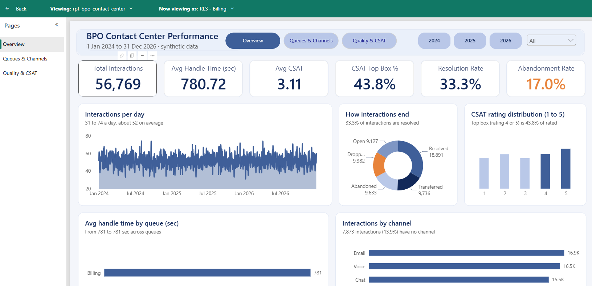
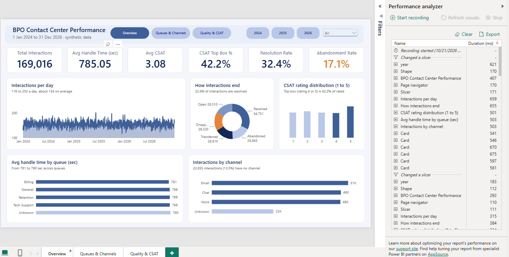
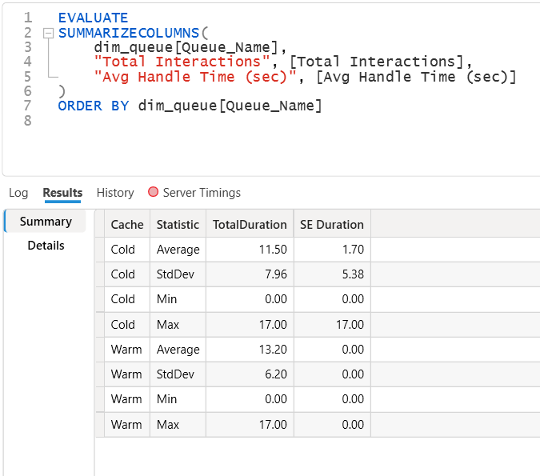
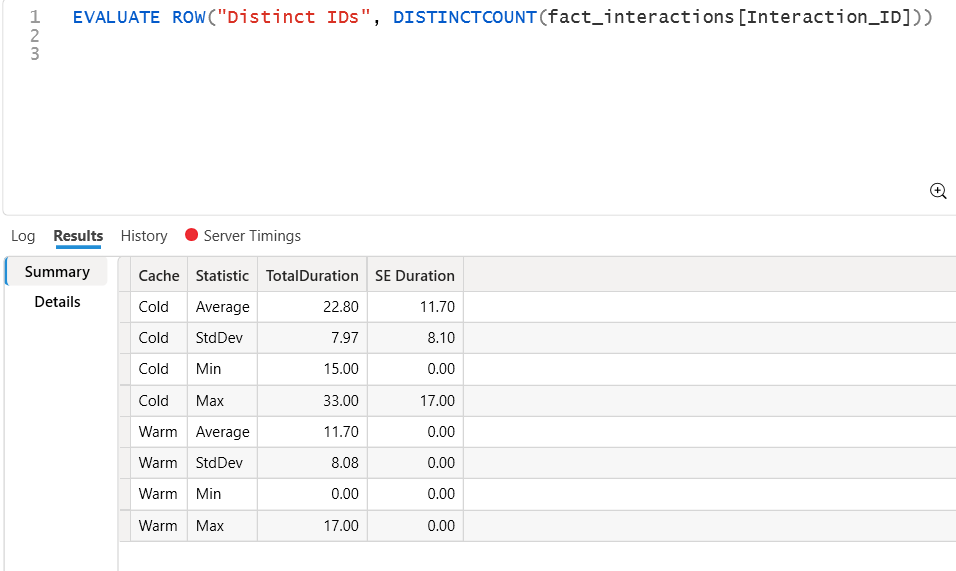
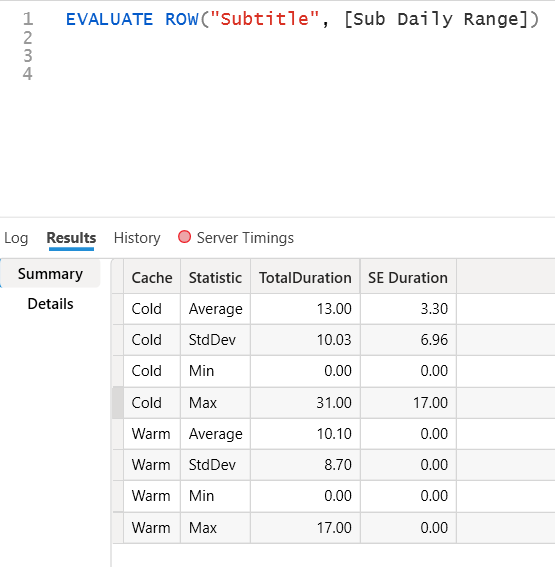

# BPO Contact Center Optimization Pipeline

An end-to-end data engineering and analytics solution built on Microsoft Fabric. This project processes multi-year customer interaction data using a Medallion Architecture, optimizing query performance via Direct Lake mode, and enforcing robust data governance.

## 📊 Dashboard Preview

A three-page Power BI report on a Direct Lake semantic model, built on **synthetic data** (1 Jan 2024 to 31 Dec 2026, 169,016 interactions). Screenshots are from the development workspace (DEV2).

> **Why screenshots and not a live link?** The semantic model uses row-level security, which Power BI's Publish to web does not support, and the project runs on a temporary Fabric trial. The report is fully interactive in Fabric: the year tiles and month dropdown filter all pages, and the page buttons navigate between them.

### Page 1: Overview

Six KPI cards, daily demand, how interactions end, CSAT rating distribution, handle time by queue, and interactions by channel. The subtitles are calculated by DAX measures and change with the slicers.

### Page 2: Queues & Channels

Abandonment and resolution rates by queue and by channel, with queue and channel filter buttons.

### Page 3: Quality & CSAT

CSAT by queue and channel, top-box rate by queue, and a queue scorecard.

### Short walkthrough

A fully interactive three-page Power BI report built on a Direct Lake semantic model using synthetic data. 

https://github.com/user-attachments/assets/3fab7bce-d51d-4036-95be-d2b579a3bdc2

### What the data shows
- **169,016** cleaned interactions over three years (1 Jan 2024 to 31 Dec 2026), about 154 a day: **32.4%** resolved, **17.1%** abandoned, average CSAT **3.08 / 5**, top box (rating 4 or 5) **42.2%**, average handle time **785 seconds**. The three years are almost the same: 56,543, 56,245 and 56,228 interactions.
- Queues and channels are close to each other: abandonment runs from 16.3% (Retention) to 18.0% (General), resolution from 31.3% to 33.3%, and average CSAT from 2.98 (General) to 3.18 (Tech Support). These gaps are small and the data is generated, so they are not business findings. The point of the project is the pipeline, model and report design.
- 13.5% of interactions have no channel and 16.8% have no queue. They stay visible as "Unknown", so the totals match.

---

## 🏗️ Architecture Overview
The pipeline follows a structured Medallion Architecture managed natively via Microsoft Fabric Git Integration:
* **Bronze Layer:** Parameterized incremental ingestion of raw operational files into Delta tables using Data Factory.
* **Silver Layer:** Idempotent cleaning, data-quality auditing, and automated quarantine routing using PySpark.
* **Gold Layer:** Dimensional modeling transforming cleaned interaction logs into a high-performance Star Schema.
* **Semantic Layer:** Direct Lake semantic model with measure-only DAX expressions and Row-Level Security (RLS).

---

## 🛠️ Tech Stack & Core Tools
* **Orchestration & Ingestion:** Microsoft Fabric Data Factory (Pipelines & Copy Activities) ✅
* **Compute & Engineering:** Apache Spark (PySpark Notebooks) ✅
* **Storage Engine:** Delta Lake (Parquet format) ✅
* **Modeling & Security:** Fabric web model editor (Direct Lake semantic model, DAX measures, static row-level security roles) ✅
* **Performance Tuning:** DAX Studio (XMLA connection, Server Timings, Benchmark with cache cleared vs warm) ✅
* **DevOps (Phase 5):** Fabric Git Integration ✅, Deployment Pipelines ✅ (manual promotion across Development, Test and Production)

---

## 📈 Project Status & Metrics Log
*This section is a living log: results for each phase, with what was verified and what was not.*

<details>
<summary><b>Phase-by-phase results, verification and limitations (click to expand)</b></summary>
  
### Phase 0: Data Augmentation ✅
- **Goal:** Turn a 5,000-row messy seed CSV into a 180,000-row synthetic source, reproducibly.
- **Method:** Loaded the seed as strings, cast `Talk_Time_Sec` with `try_cast` so bad values become null instead of causing an error, cross-joined with a 2024-01-01 to 2026-12-31 date spine, shuffled and limited to 180,000 rows, regenerated `Talk_Time_Sec` from the seed's mean and standard deviation, and injected anomalies (~2% `CSAT_Rating` set to "Five", ~1% `Agent_ID` set to null).
- **Reproducibility:** `SEED = 42`. Phase 0B added fixed seeds 43 to 46 for the other random steps.
- **Output:** 180,000 unique tickets from 2024-01-01 to 2026-12-31, written as one CSV that replaced the file in the public data repo. The seed file is now stored in the data repo too, because Git does not save lakehouse files.
- **Verified:** Silver 169,016 rows (no duplicate IDs) and quarantine 10,984, which together equal the 180,000 Bronze rows. Gold fact table 169,016 with 0 orphan keys, and the Total Interactions card shows 169,016. All 5,393 day-first timestamps were read correctly (0 Silver rows where the Timestamp date differs from `sim_date`). The new file has 5,305 rows with CSAT "Five" and 3,675 null `Agent_ID` values.
- **Known limitation:** Both injections used the same random seed, so the two anomalies probably overlap heavily. Fixed in Phase 0B.

### Phase 0B: Data Fix ✅
- **Goal:** Replace the repeated test data with a realistic 3-year dataset where every ticket is unique.
- **Method:** Gave every row its own Interaction_ID, built Timestamp from a daily date spine plus a random time of day, and used separate random seeds for the injected data problems (text CSAT values, missing Agent_ID, day-first dates). Reloaded through the pipeline after resetting the watermark.
- **Output:** 180,000 unique tickets from 2024-01-01 to 2026-12-31.
- **Verified:** Silver 169,016 rows (no duplicate IDs), quarantine 10,984, Gold fact table 169,016, no orphan keys, report total matches.
- **Known limitation:** Reading staging through the SQL endpoint right after it changes can return the old data for a short time. The first reload after the fix loaded old data and needed a clean rerun.

### Phase 1: Bronze Ingestion Pipeline ✅
- **Goal:** Load raw ticket data into Bronze incrementally, so each run only picks up rows newer than the last load.
- **Method:** Pipeline `pl_ingest_bpo_tickets` runs 4 activities in order: `cp_http_to_staging` (HTTP CSV to `dbo.stg_customer_tickets`, Overwrite), `lkp_get_watermark` (reads `control.load_log`), `cp_staging_to_bronze` (T-SQL filter `try_cast(sim_date AS DATE) > watermark`, Append to `dbo.bronze_customer_tickets`), and `nb_update_watermark` (runs `nb_setup_control_table` to save the new newest date).
- **Watermark design:** `control.load_log` holds exactly one row, upserted with `MERGE INTO` inside `update_watermark()`. The Lookup activity can only read a table's first row, so one row keeps the read simple.
- **Parameters:** `p_source_path`, `p_load_date`, `p_environment`.
- **Resilience:** Retry 2 times, 60 seconds apart, on the notebook activity, because trial Spark capacity sometimes throttles (HTTP 430).
- **Verified:** In the original build, 180,000 rows in staging and Bronze, watermark = 2026-12-31 with `rows_loaded` = 180,000. A 2,000-row test batch dated January 2027 loaded only the new rows, and a rerun loaded 0. After the Phase 0B data fix, a full reload loaded 180,000 rows with 180,000 distinct `Interaction_ID` values. The January 2027 test batch was not repeated after the fix.
- **Known limitation:** Bronze keeps the raw data as it arrived, including messy values that Silver cleans. The watermark follows the `sim_date` column. Since Phase 0B, every Silver row's `Timestamp` falls on its own `sim_date`, so the dashboard dates and the watermark cover the same range (2024-01-01 to 2026-12-31). `cp_staging_to_bronze` reads staging through the SQL analytics endpoint, which can show old data for a short time after staging changes. After the Phase 0B fix, the first run loaded the old data this way and a clean rerun was needed. The endpoint lag is the likely cause, but it was not proven.
- **Full reload:** Because the Bronze copy uses Append, a full reload needs three steps: delete the rows in Bronze, set `last_loaded_date` in `control.load_log` back to 1900-01-01, then rerun the pipeline.
- **Failure alerting:** Each of the four pipeline activities has a red On fail path to `nb_log_pipeline_alert`, which writes the pipeline name, run ID, failed activity, and error message to `control.pipeline_alerts`. A Fail activity then ends the run as Failed so errors can't hide as green runs. The chain between activities uses On success links, so a failed step stops everything after it.
- **Verified (alerting):** Tested end to end by making a temporary test activity fail on purpose: the run showed Failed in Monitor and the alert row held the real run ID and error text. The same pattern was copied to the four real activities, which passed validation, and a normal run succeeded with staging and Bronze both at 180,000 rows.
- **Known limitation (alerting):** The alert logger runs on Spark, so it can be delayed or fail when the trial capacity is throttled (HTTP 430). The alert is a table, not an email or Teams message.

### Why a Data Pipeline instead of Dataflow Gen2?
- A pipeline is built for orchestration: ordered steps, parameters, passing a value (the watermark) between activities, retries, and calling notebooks.
- Dataflow Gen2 is a low-code Power Query tool for shaping data. It cannot easily read a watermark, use it as a filter, and update it afterwards in one controlled flow.
- The pipeline moves and tracks the data. Transformations happen later in notebooks (Silver and Gold).

### Phase 2: Silver Cleaning ✅
- **Goal:** Turn raw Bronze data into trusted, one-row-per-ticket Silver data, and keep every rejected row with a reason.
- **Method:** PySpark in `nb_phase2_silver_build`. Standardized labels (Channel, Queue_Name, Status), converted types with `try_cast`, read two timestamp formats, repaired the CSAT word "Five" as 5, and treated hold time "N/A" as null. Rows with a non-numeric CSAT, missing Agent_ID, missing Timestamp, or invalid talk/hold time go to quarantine with a reason. Quarantine runs before deduplication, then the latest row per Interaction_ID is kept using a window function.
- **Output:** `dbo.silver_customer_tickets` (169,016 rows), `dbo.quarantine_customer_tickets` (10,984 rows), `dbo.silver_dq_audit` (one row per run).
- **Verified:** Silver (169,016) plus quarantine (10,984) equals the 180,000 Bronze rows. Silver has one row per ID, no null Agent_ID or Timestamp, no negative talk time, and all day-first timestamps read correctly. Re-running the writes gave identical counts (idempotent).
- **Known limitation:** 10,984 of 180,000 tickets (6.1%) are in quarantine only, because they have a missing Agent_ID or an invalid talk or hold time. Every Interaction_ID now has one row, so the "keep the latest row per ID" step removes nothing and works as a safeguard.

### Phase 2B: Gold Star Schema ✅
- **Goal:** Reshape the clean Silver data into a star schema that Direct Lake and Power BI can query quickly.
- **Method:** Built four dimension tables (`dim_agent`, `dim_channel`, `dim_queue`, `dim_date`) with surrogate keys, then `fact_interactions` at one row per Interaction_ID. Null Channel and Queue values map to an "Unknown" member, so no rows are lost in the joins. `dim_date` covers 2024 to 2027 so it also covers the January 2027 incremental test batch. Every table is rebuilt with Overwrite, so re-runs are safe.
- **Output:** `dbo.dim_agent` (40), `dbo.dim_channel` (4), `dbo.dim_queue` (5), `dbo.dim_date` (1,461), `dbo.fact_interactions` (169,016).
- **Verified:** Fact rows match Silver rows and distinct IDs (169,016). 0 orphan keys across all four dimensions. Identical results on re-run (idempotent).
- **Known limitation:** About 14% of facts have an Unknown channel (22,855 rows) and about 17% have an Unknown queue (28,447 rows), because those nulls were deliberately kept in Phase 2. `Status` is kept in the fact table as a plain text column instead of its own dimension.

### Phase 3: Direct Lake Semantic Model + RLS ✅
- **Goal:** Build a semantic model on the Gold star schema, with relationships, DAX measures and row-level security (RLS), reading the Delta tables directly in Direct Lake mode.
- **Method:** Created `sm_bpo_contact_center` as Direct Lake on SQL endpoint from the five Gold tables. Four many-to-one, single-direction relationships from `fact_interactions` to each dimension, with `dim_date` marked as the date table. Direct Lake Behavior is set to Direct Lake Only, so a query that cannot be served from the Delta files shows an error instead of silently falling back to DirectQuery. Key and helper columns are hidden, `month_name` and `day_name` have sort-by columns, and Discourage implicit measures is on. 10 explicit DAX measures sit in display folders (Time Metrics, Customer Satisfaction, Outcomes). 4 RLS roles (`RLS - Billing`, `RLS - General`, `RLS - Retention`, `RLS - Tech Support`) each filter `dim_queue` by `Queue_Name`. Testing the roles needed a fixed-identity cloud connection (OAuth 2.0, SSO off), because "Test as role" does not work with the Direct Lake SSO default.
- **Output:** Semantic model `sm_bpo_contact_center` and a starter report `rpt_bpo_contact_center` (card, queue table, monthly column chart).
- **Verified (original 4,925-row data):** Total Interactions = 4,925, matching `fact_interactions`. Viewing as `RLS - Billing` shows only Billing (1,655), and viewing as `RLS - Retention` shows only Retention (811). Months sort January to March, not alphabetically. Performance analyzer showed no errors on any visual under Direct Lake Only, so there was no fallback to DirectQuery. After Phase 0B the model was refreshed on the new data and Total Interactions = 169,016, matching `fact_interactions`. The RLS roles were re-tested on the new data in Phase 3C.
- **Known limitation:** Interactions with an Unknown queue (828 originally, 28,447 after Phase 0B) are not visible to any queue role, by design. The roles have no members assigned (testing used "Test as role" only). Avg Handle Time does not equal Avg Talk Time + Avg Hold Time, because Avg Hold Time skips interactions with no hold value, while handle time counts a missing hold as 0. Resolution Rate divides by all interactions, including Open ones. Abandonment Rate counts only the "Abandoned" status, and "Dropped" is kept separate. The fixed-identity connection `conn_bpo_lakehouse_fixed` is a Fabric account setting and is not stored in Git. The report is a starter with three visuals, and the full dashboard is Phase 3B.

### Phase 3B: Power BI Report, first version ✅
- **Goal:** Build a one-page contact center dashboard on top of the Direct Lake semantic model, with every number coming from model measures.
- **Method:** Built `rpt_bpo_contact_center` in the Fabric web editor as a thin report connected to `sm_bpo_contact_center`. Added the measure `CSAT Top Box %` (ratings of 4 or 5 divided by rated interactions, so unrated interactions are excluded).
- **Output:** One page with 6 KPI cards (Total Interactions, Avg Handle Time, Avg CSAT, CSAT Top Box %, Resolution Rate, Abandonment Rate), a monthly chart, a channel chart, a queue table, and Queue and Channel slicers. Unknown queue/channel members stay visible so totals match 4,925.
- **Verified (original 4,925-row data):** Cards match the model (4,925 / 788.92 / 3.06 / 32.5% / 16.9%). Top Box check: 778 + 946 = 1,724 of 4,148 rated = 41.6%. Month and channel bars each add up to 4,925. Voice + Billing slicers gave 485, matching the table. Viewing as `RLS - Billing` showed 1,655 only. Performance analyzer showed no fallback errors under Direct Lake Only (slowest first load about 1.7 s, a rough check, not the Phase 4 benchmark).
- **Known limitation:** At the time, the data was synthetic and covered only 1 Jan to 2 Mar 2026 (March was partial), so differences between queues and channels were not meaningful business insights. The slicers showed an extra (Blank) member with no rows behind it; it is hidden with an "is not blank" filter on each slicer and the cause was not confirmed. Top Box has no single official definition; this project uses 4 or 5.
- **Evidence:** The RLS screenshot was retaken on the redesigned report with the 169,016-row data.
  
  

### Phase 3C: Redesigned report rebuilt on the full data ✅
- **Goal:** Rebuild the three-page navy report in the Git-connected workspace on the new 169,016-row data, with no hard-coded numbers in the text.
- **Method:** The three-page design was first built in the test workspace on the old data, so it was copied into DEV2 with Semantic Link Labs (`clone_report`) and bound to the DEV2 model. Replaced the month tiles with year tiles plus a month dropdown, because month tiles alone would add the same month of three years together. Moved every subtitle that shows a number, and the header date line, into DAX measures (display folder "Subtitles") connected through the subtitle "Field value" setting, so the text follows the slicers. Added a thousands separator to the count measures.
- **Output:** `rpt_bpo_contact_center` (Overview, Queues & Channels, Quality & CSAT) and 16 new measures in `sm_bpo_contact_center` (13 text measures for the subtitles and date line, 3 helper measures for the daily average, minimum and maximum).
- **Verified:** The KPI cards, the queue, channel and year breakdowns, and the daily minimum, maximum and average were checked against SQL queries on the SQL analytics endpoint. Total 169,016; Avg Handle Time 785.05; Avg CSAT 3.08; CSAT Top Box 42.2%; Resolution Rate 32.4%; Abandonment Rate 17.1%; yearly counts 56,543 / 56,245 / 56,228. Row-level security retested on the new data: Billing 56,769, General 28,284, Retention 27,631, Tech Support 27,885.
- **Known limitation:** The date table covers four years but the data covers three, so the year slicer is filtered by hand to 2024 to 2026. A later year (for example the January 2027 test batch) stays hidden until that filter is changed. The four RLS roles do not include the Unknown queue, so those 28,447 interactions are hidden from every role.

### Phase 4: Performance Profiling ✅
- **Goal:** Measure how fast the semantic model answers queries, with the engine cache cleared (cold) and with the cache warm.
- **Method:** Connected DAX Studio to `sm_bpo_contact_center` through the XMLA endpoint and used its Benchmark tool, which runs one query several times with the cache cleared before each run (cold) and several times with the cache warm, and logs the timings. Ran three saved DAX queries, 10 cold and 10 warm runs each: a queue summary like the report table, a distinct count on `Interaction_ID`, and the subtitle measure `Sub Daily Range`.
- **Output:** Three query files and a short note in `docs/diagnostics/`, and three benchmark screenshots in `docs/screenshots/`.
- **Verified:** The first two queries gave the same results as the SQL checks (queue totals as in Phase 3C, 169,016 distinct IDs). Average total time was 10 to 23 ms in every case: queue summary 11.5 ms cold and 13.2 ms warm, distinct count 22.8 ms cold and 11.7 ms warm, subtitle measure 13.0 ms cold and 10.1 ms warm. The slowest single run was 33 ms. All queries ran without errors under Direct Lake Only, so none fell back to DirectQuery.
- **Known limitation:** "Cold" means the engine cache was cleared before each run. It does not mean a column was loaded from OneLake, because the columns were already in memory (clearing the cache and refreshing the model did not produce that case). The timer moves in steps of about 16 ms, so only differences of two or more steps mean anything. The queue summary and the subtitle measure are the same cold and warm within that noise. Only the distinct count shows a clear gap (about 23 ms against 12 ms), because the cold runs spent time in the storage engine and the warm runs did not. One earlier first run of the distinct count took 188 ms, mostly in the formula engine; it was not repeated, so the cause is not confirmed. Queries ran as admin, so row-level security was not applied. 169,016 rows on a trial capacity is small data, so these timings say nothing about large-scale performance.
- **Evidence:** Benchmark summary tables for the queue summary, the distinct count and the subtitle measure. The query files and note are in `docs/diagnostics/`.




### Rebuild from Source Control ✅

- **Goal:** Prove the whole solution can be rebuilt from GitHub alone if a workspace is lost (the 60-day Fabric trial ended).
- **Method:** Created a new workspace on a new trial capacity in a different region, connected it to this repo and synced all 11 items. Items arrive without data, so I re-attached the lakehouse in the 6 notebooks, created new connections, re-ran the pipeline, Silver and Gold notebooks, repointed the Direct Lake model to the new lakehouse with the semantic-link-labs function `update_direct_lake_model_connection`, and recreated the fixed-identity connection used for row-level security.
- **Output:** A working copy of the full solution, with the updated notebook, pipeline and model definitions committed.
- **Verified:** The rebuild was done before the Phase 0B data fix, so these counts are for the first dataset (180,000 rows that repeated only 5,000 ticket IDs, so Silver kept 4,925). Every count matched the original workspace: 180,000 rows in staging and Bronze, 4,925 in Silver, 11,675 in quarantine, dimensions 40 / 4 / 5 / 1,461 and 4,925 fact rows. The report KPIs and all four RLS roles matched too. The data was replaced later in Phase 0B (169,016 in Silver); the current numbers are in Phase 0B and Phase 3C.
- **Known limitation:** Git saves item definitions only, not data, connections or the deployment pipeline. A workspace cannot move to a capacity in another region while it holds Fabric items, so this was a rebuild, not a move. Connections had to be recreated by hand.

### Phase 5: Deployment ✅
- **Goal:** Promote the solution from Development to Test to Production with a Fabric Deployment Pipeline, and check that each stage works with its own data.
- **Method:** Used the rebuilt workspace (see Rebuild above) as the Development stage, named DEV2, and created two more workspaces, TEST2 and PROD2, plus one Deployment Pipeline, `dp_bpo_contact_center`. DEV2 is Git-connected; TEST2 and PROD2 are not. Deployed the 11 items from Development to Test, then from Test to Production. In Test and in Production, ran the control setup cells of `nb_setup_control_table`, the ingest pipeline, and the Silver and Gold notebooks, repointed the semantic model to that stage's lakehouse with `update_direct_lake_model_connection` (semantic-link-labs), and refreshed it. After Phase 0B and Phase 3C, the stages were redeployed (Development to Test to Production) and reloaded with the new data.
- **Output:** Three working stages, each with its own lakehouse data, semantic model and report.
- **Verified:** Same counts in all three stages on the 169,016-row dataset (after Phase 0B): Bronze 180,000 rows with 180,000 distinct IDs, Silver 169,016, dimensions 40 / 4 / 5 / 1,461, fact 169,016. The report pages were compared across the three stages and match (Overview: Total 169,016, Avg Handle Time 785.05, Avg CSAT 3.08, Top Box 42.2%, Resolution 32.4%, Abandonment 17.1%). After the repoint, the lineage view shows the report, model, SQL endpoint and lakehouse together in the same workspace in each stage. Row-level security was tested with "Test as role" in Development only (retested on the new data in Phase 3C).
- **Known limitation:** Deployment copies items, not data, so each stage loaded its own data by running the pipeline and notebooks. The semantic model was not rebound automatically: in Production it first pointed at the Test lakehouse until it was repointed by hand. That repoint is not stored in Git or the pipeline, so Test and Production show the model as "Different from source". The model's Data source rules offered no options. The first pipeline run in Test failed once with an "invalid object" error and succeeded on rerun with no changes, probably a SQL endpoint sync delay (not confirmed). Promotion is started by hand; GitHub Actions or fabric-cicd was not built. The pipeline parameter `p_environment` keeps its default value "dev" in every stage. All three workspaces use Runtime 1.3 (Spark 3.5) with no default environment. The four roles were deployed with the model (visible on the Row-Level Security page in Test), but "Test as role" was refused in Test because the model uses the default single sign-on. The fixed-identity connection it needs is an account setting, not stored in Git or carried by deployment. 
- **Second round (after Phase 0B and Phase 3C):** Test and Production were reloaded with the new data: delete the Bronze rows, reset the `control.load_log` watermark to 1900-01-01, rerun the pipeline, then rerun the Silver and Gold notebooks. The repoint had to be repeated, because each deployment copies the model's connection from the stage before. A report re-created by cloning is a new item, so the pipeline did not pair it with the old report of the same name; the old report was renamed before deploying and deleted afterwards.
- **Evidence:** 


  </details>
  
## Build Progress
- [X] Phase 0: Synthetic data augmentation
- [X] Phase 0B: Data fix (unique IDs, real timestamps)
- [X] Phase 1: Bronze ingestion pipeline
- [X] Phase 1: Failure/alert path
- [X] Phase 2: Silver cleaning
- [X] Phase 2B: Gold star schema
- [X] Phase 3: Direct Lake semantic model + RLS
- [X] Phase 3B: Power BI report (contact center dashboard)
- [X] Phase 3C: Redesigned report rebuilt on the full data
- [X] Phase 4: Performance profiling
- [X] Rebuild from source control
- [X] Phase 5: Deployment (Development, Test, Production)

---

## 📁 Repository Structure

Folder names such as `.Lakehouse`, `.Notebook`, and `.DataPipeline` are created automatically by Fabric Git integration. Only item definitions are stored here. Table data, connections and the Phase 5 deployment pipeline (`dp_bpo_contact_center`) are not in Git.

```text
BPO-Contact-Center-Optimization/
├── BPO_Optimization_Lakehouse.Lakehouse/          # Lakehouse definition (Bronze/Silver/Gold tables live here)
├── BPO_Spark_Environment.Environment/             # Spark environment settings
├── nb_phase0_data_augmentation.Notebook/          # Phase 0 and 0B: builds the 180,000-row synthetic source (unique IDs, real timestamps)
├── pl_ingest_bpo_tickets.DataPipeline/            # Phase 1: parameterized incremental pipeline, HTTP source to Bronze Delta table
├── nb_setup_control_table.Notebook/               # Phase 1: creates control.load_log and update_watermark()
├── nb_log_pipeline_alert.Notebook                 # Phase 1: Writes one alert row per pipeline failure to control.pipeline_alerts
├── nb_phase2_silver_profile.Notebook              # Phase 2: Read-only profile of Bronze (shape, nulls, value ranges)
├── nb_phase2_silver_build.Notebook                # Phase 2: Silver build: clean, quarantine, deduplicate, write, verify
├── nb_phase2b_gold_build.Notebook                 # Phase 2B: Builds Gold dimensions and fact table
├── sm_bpo_contact_center.SemanticModel/           # Phase 3: Direct Lake semantic model (relationships, measures, RLS roles)
├── 28f29fa0-c20f-a156-448f-ecbee72827f3.Report/   # Phase 3, 3B and 3C: Power BI report (Fabric named this folder by item ID)
├── docs/screenshots/                              # Phase 3, 3B, 4 and 5 evidence screenshots
├── docs/diagnostics/                              # Phase 4: DAX Studio query files and cold vs warm comparison note
└── README.md
```

**Source data:** the raw CSV that the pipeline downloads lives in a separate public repo, which acts as the external source system: [bpo-contact-center-fabric](https://github.com/Ronin-29/bpo-contact-center-fabric).
